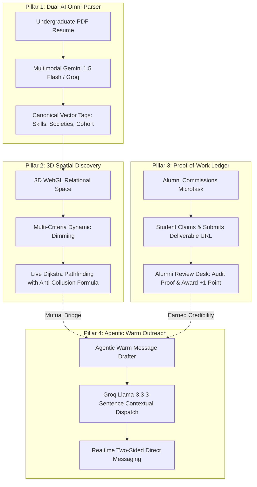

# Credence — by Broken Table

<div align="center">

```
   ______              __                      
  / ____/_______  ____/ /__  ____  ________    
 / /   / ___/ _ \/ __  / _ \/ __ \/ ___/ _ \   
/ /___/ /  /  __/ /_/ /  __/ / / / /__/  __/   
\____/_/   \___/\__,_/\___/_/ /_/\___/\___/    
```

### *The 3D Relational Knowledge Graph & Proof-of-Work Alumni Network*

[](https://github.com/sparshagarwal0411/alumni-collective)
[](https://react.dev/)
[](https://www.typescriptlang.org/)
[](https://threejs.org/)
[](https://tanstack.com/)
[](https://tailwindcss.com/)
[](https://groq.com/)
[](https://supabase.com/)

</div>

---

## 📖 Overview

Traditional university alumni directories are static "phonebooks." Students spam cold messages on LinkedIn with a 2% response rate, while graduates are overwhelmed with unfocused connection requests offering zero signal of actual capability.

**Credence**, engineered by **Broken Table**, fundamentally re-engineers alumni connectivity. It replaces cold recruitment noise with **verified proof-of-work** and **interactive 3D relational topology**. Instead of asking for unearned favors, undergraduates build credibility through concrete code teardowns and design audits, while graduates easily discover pre-vetted institutional talent.

---

## 🏛️ The 4 Core Architectural Pillars



---

### 1. ⚡ Dual-AI Omni-Parser Onboarding
* **Multimodal Document Extraction:** Ingests PDF resumes directly using **Gemini 1.5 Flash** to extract technical proficiencies, campus leadership, and coursework in $< 1\text{s}$.
* **GitHub Repository Sync:** Analyzes public commit history and repository languages via **Groq Llama-3** to structure open-source contributions.
* **Resilient Deterministic Taxonomy Fallback:** Built-in campus taxonomy resolver matches against authentic societies (*DevComm*, *The Debugging Society*, *IEEE*), engineering branches, and technology clusters with zero external API dependencies.
* **1-Click Sample Ingestion:** Includes instantaneous sample profile loading for streamlined product demonstrations.

### 2. 🌌 3D WebGL Relational Knowledge Graph
* **Interactive Force-Directed Space:** Built with **Three.js** and WebGL, rendering alumni, faculty, and student nodes in an anti-hairball, spatial coordinate matrix.
* **Dynamic Multi-Criteria Dimming:** Selecting employers (e.g. *Anthropic*, *Stripe*, *Google DeepMind*), departments, or societies highlights matching nodes while dimming unrelated vertices to $20\%$ opacity.
* **Live Dijkstra Shortest-Path Calculation:** Offloads graph traversal to dedicated **Web Workers** (`dijkstra.worker.ts`), computing the lowest-resistance path between an undergraduate and any target alumnus using our anti-collusion resistance formula:
$$\text{Weight} = \frac{1}{\min(5, \text{Points}) \times 5 + \text{Shared Societies} \times 2 + 0.1}$$

### 3. 🛡️ Proof-of-Work Microtask Ledger & Alumni Review Desk
* **Binary Credibility Points ($0$ or $1$):** Replaces vanity endorsements with verifiable deliverables. Students complete 1–3 hour micro-internships, architecture reviews, or compiler benchmarks.
* **Deliverable Evidence Vault:** Students submit live Google Drive links, GitHub Pull Requests, or source archives alongside contextual submission notes.
* **Alumni Review Desk:** A dedicated grading console allowing alumni to inspect submissions, provide structured feedback, and award verified $+1$ credibility points.
* **Role Integrity & Governance:** Non-alumni are barred from posting tasks, while student claims are preserved exclusively for active learners.

### 4. 💬 Agentic Warm Outreach & Relevance Messaging
* **Groq Llama-3.3 Warm Drafter:** Synthesizes mutual campus societies, branch lineage, and completed microtask deliverables into a professional, respectful 3-sentence introduction.
* **Two-Sided Chat Interface:** Clean separation between outbound dispatches (terracotta right-aligned) and inbound responses (paper left-aligned).
* **Simulated Conversational Reply:** Includes an automated 1.5-second alumni response simulation to demonstrate active chat loops during live walkthroughs.

---

## 🎭 Role-Based Perspectives Matrix

| Capability | Student Persona (`Dev / Arjun Sharma`) | Alumni Persona (`Vikram Choudhury`) | Faculty Persona (`Prof. Gayatri Sen`) |
| :--- | :---: | :---: | :---: |
| **Omni-Parser Resume Ingestion** | ✅ Full Access | 👁️ View Dossier | 👁️ View Dossier |
| **3D Knowledge Graph & Dijkstra** | ✅ Student Origin Node | ✅ Alumni Origin Node | 👁️ Institutional Overview |
| **Claim Proof-of-Work Microtask** | ✅ Active | 🚫 Disabled (Lock) | 🚫 Disabled (Lock) |
| **Post Microtasks (Commission)** | 🚫 Restricted | ✅ Active | 🚫 Restricted |
| **Alumni Review Desk & Grading** | 👁️ View Grade & Notes | ✅ Full Audit & $+1$ Pt | 👁️ View Ledgers |
| **Agentic Warm Messaging** | ✅ Compose & Send | ✅ Receive & Reply | ✅ Mentor Inquiries |
| **Event RSVPs & Access** | ✅ Attendee | ✅ Speaker / Attendee | ✅ Academic Host |

---

## 🛠️ Technology Stack

```
Credence Architecture
├── Frontend Core: React 19 · TypeScript 5.8 · Vite 8
├── Routing & Query: TanStack Router · TanStack Query
├── Visualizations: Three.js · WebGL · Web Workers
├── Design System: Tailwind CSS v4 · Radix UI · Lucide Icons · Sonner Toaster
├── AI Orchestration: Gemini 1.5 Flash · Groq Llama-3.3-70b · Llama-3.1-8b
└── Backend Infrastructure: Supabase (PostgreSQL · Realtime · Auth · RLS)
```

---

## 📂 Project Directory Structure

```text
final/
├── src/
│   ├── components/
│   │   ├── bounties/           # Alumni Review Desk & Submission Modals
│   │   ├── companies/          # Canonical corporate brand emblems
│   │   ├── graph/              # Three.js 3D WebGL Spatial Canvas
│   │   ├── microtasks/         # Proof-of-Work task manager & ledger
│   │   ├── network/            # Credibility audit popovers & inspector
│   │   ├── onboarding/         # Dual-AI Omni-Parser Modal wizard
│   │   ├── site/               # Chrome header, navigation, & editorial layouts
│   │   └── ui/                 # TagChip clusters, dialogs, & sonner toasts
│   ├── data/
│   │   ├── nsutTaxonomy.ts     # Authentic societies, branches, & domains
│   │   └── seedData.ts         # Canonical profiles & 39 relational edges
│   ├── lib/
│   │   ├── auth.tsx            # Multi-role authentication & demo switchers
│   │   ├── chatStore.ts        # Unified message storage & auto-reply loop
│   │   ├── studentProfile.ts   # Student dossier schema & local persistence
│   │   └── supabaseSync.ts     # Postgres sync, task claiming, & atomic grading
│   ├── routes/
│   │   ├── alumni.$id.tsx      # Comprehensive individual alumni dossiers
│   │   ├── messages.tsx        # High-relevance messaging & warm drafter
│   │   ├── network.tsx         # 3D Graph Studio with Dijkstra shortest-path
│   │   ├── student.tsx         # Undergraduate Folio & Omni-Parser integration
│   │   └── tasks.tsx           # Microtasks ledger & Alumni Review Desk
│   ├── services/
│   │   ├── aiService.ts        # Dual-AI Omni-Parser & Groq warm drafter
│   │   └── dijkstraService.ts  # Dijkstra pathfinder with worker fallback
│   └── workers/
│       └── dijkstra.worker.ts  # Background thread path calculation
├── package.json
└── vite.config.ts
```

---

## 🚀 Getting Started

### Prerequisites
* **Node.js**: v18.0.0 or higher
* **npm** or **pnpm**

### Installation

1. **Clone the repository:**
   ```bash
   git clone https://github.com/sparshagarwal0411/alumni-collective.git
   cd alumni-collective
   ```

2. **Install dependencies:**
   ```bash
   npm install
   ```

3. **Configure Environment Variables:**
   Create a `.env` file in the project root:
   ```env
   VITE_SUPABASE_URL=your_supabase_url
   VITE_SUPABASE_PUBLISHABLE_KEY=your_supabase_publishable_key
   
   # Optional AI Accelerators (Deterministic fallbacks active if omitted)
   VITE_GEMINI_API_KEY=your_gemini_api_key
   VITE_GROQ_API_KEY=your_groq_api_key
   ```

4. **Launch the Development Server:**
   ```bash
   npm run dev
   ```
   Open [http://localhost:8080](http://localhost:8080) in your browser.

5. **Verify Production Build:**
   ```bash
   npm run build
   ```

---

## 🎬 2-Minute Demo Flow

```
[0:00 - 0:15] Hook: "Credence by Broken Table replaces cold LinkedIn DMs with verified proof-of-work."
     │
[0:15 - 0:42] /student: Open Omni-Parser -> Load Sample Resume -> Run AI Ingestion -> Apply to Dossier.
     │
[0:42 - 1:12] /network: 3D Knowledge Graph -> Filter by "Anthropic" -> Click node -> Run live Dijkstra Path.
     │
[1:12 - 1:40] /tasks: Switch to Alumni -> Open "Review Desk" -> Inspect deliverable -> Award +1 Credibility Pt.
     │
[1:40 - 2:00] /messages: Click "AI Warm Intro Drafter" -> Synthesize mutual ties -> Send -> Instant reply.
```

---

## 👥 Credits

Crafted with dedication for **HackShift 2026**.

**Made with ❤️ by Broken Table**
* **Repository:** [sparshagarwal0411/alumni-collective](https://github.com/sparshagarwal0411/alumni-collective)

---

## 📄 License
This project is licensed under the MIT License.
